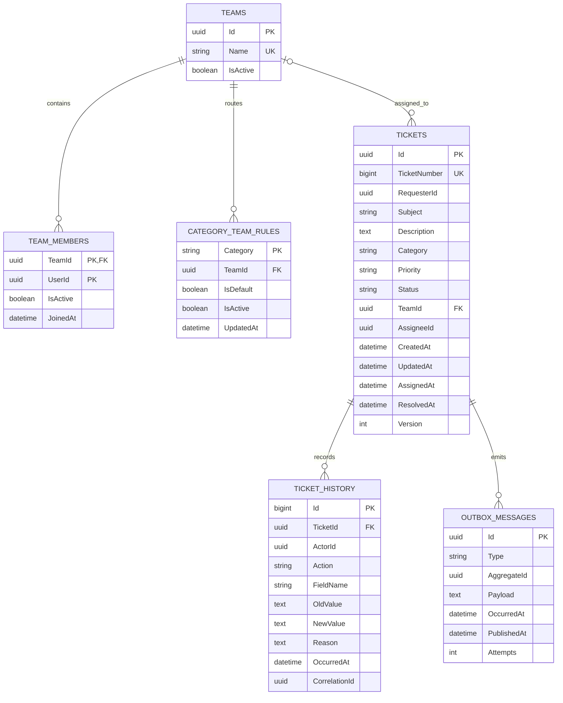

# Tuần 1 — Yêu cầu, ERD và API contract

## 1. Mục đích

Hệ thống giúp khách hàng gửi và theo dõi yêu cầu hỗ trợ. Nhân viên xử lý theo trạng thái; dữ liệu ticket và lịch sử được lưu lâu dài. Trong tuần 1–3, ưu tiên luồng REST và dữ liệu; RabbitMQ/Worker/SignalR được hoàn thiện ở giai đoạn tiếp theo.

## 2. Vai trò

| Vai trò | Quyền trong MVP |
|---|---|
| Customer | Tạo ticket; xem danh sách, chi tiết và lịch sử ticket của chính mình. |
| Agent | Xem/cập nhật trạng thái ticket được gán trực tiếp cho mình. |
| Admin | Xem ticket toàn hệ thống; cập nhật trạng thái và phục vụ vận hành. |

Danh tính production lấy từ JWT issuer bên ngoài. Môi trường Development dùng header demo để chạy thử, không dùng ở môi trường thật.

## 3. Yêu cầu chức năng

- **FR-01:** Khách hàng tạo ticket với subject, description và priority.
- **FR-02:** Ticket mới có status New, requester lấy từ danh tính đã xác thực và TicketNumber do DB cấp.
- **FR-03:** Người dùng tra cứu ticket theo quyền; danh sách có status/priority/từ khóa/khoảng ngày và phân trang.
- **FR-04:** Người dùng xem chi tiết và lịch sử thay đổi ticket được phép xem.
- **FR-05:** Agent được gán hoặc Admin đổi status theo luồng New → Assigned → InProgress → Resolved.
- **FR-06:** Mọi cập nhật có actor, thời gian, giá trị trước/sau và correlation ID.
- **FR-07:** Cập nhật ticket, history và outbox được lưu trong một transaction để các phần không lệch nhau.
- **FR-08:** Cập nhật đồng thời dựa trên Version; request dùng version cũ nhận lỗi conflict.
- **FR-09:** Hệ thống xác thực JWT ở môi trường ngoài Development và kiểm tra quyền trên từng ticket.

## 4. Yêu cầu phi chức năng ban đầu

- Lưu timestamp dưới dạng UTC.
- Giới hạn subject 200 ký tự, description 10.000 ký tự, reason 1.000 ký tự.
- Page size mặc định 20, tối đa 100.
- API không tiết lộ ticket ngoài phạm vi người gọi; trả 404 cho ticket không tồn tại hoặc không được xem.
- Credential development chỉ để local; production dùng secret manager và JWT HTTPS.
- Migration schema có version và chạy trong transaction.

## 5. Quy tắc nghiệp vụ

- Priority: Low, Normal, High, Urgent; mặc định Normal.
- Trạng thái hợp lệ: New, Assigned, InProgress, Resolved.
- Chỉ các chuyển tiếp New → Assigned, Assigned → InProgress và InProgress → Resolved được cho phép.
- Resolved là trạng thái kết thúc trong MVP; chưa hỗ trợ reopen.
- Customer chỉ được tạo ticket dưới danh tính của chính họ.
- Agent chỉ thấy ticket mà AssigneeId bằng user ID của họ. Team-wide visibility cần bổ sung sau khi quản lý membership/authorization theo team hoàn chỉnh.
- Admin có thể thấy mọi ticket và thực hiện thao tác điều phối.

## 6. ERD



User/account records do not live in this database: requester/assignee IDs are UUID claims from the configured identity system. ProcessedMessages prevents duplicate event handling. SchemaMigrations tracks applied SQL migrations.

## 7. API contract

Base URL prefix: /api/v1. JSON camelCase. Timestamps ISO-8601 UTC. Endpoints except health require authentication.

### Create ticket

`POST /tickets`

Headers: Authorization: Bearer JWT (production); X-Demo-User (Development).

Request:
```json
{
  "subject": "Cannot sign in",
  "description": "The verification code is rejected.",
  "priority": "Normal"
}
```

Response: 201 Created; body contains id, ticketNumber, requesterId, subject, description, priority, status, timestamps and version. requesterId is always taken from the authenticated identity.

### List tickets

`GET /tickets?status=Assigned&priority=High&q=login&from=2026-11-01T00:00:00Z&to=2026-11-30T23:59:59Z&page=1&pageSize=20`

Response: `{ items, page, pageSize, totalCount, hasMore }`. Order is CreatedAt descending, then Id descending. Customer scope is self; Agent scope is assignee; Admin scope is all tickets.

### Ticket detail and history

- `GET /tickets/{id}`: returns ticket detail or 404.
- `GET /tickets/{id}/history`: chronological change records.
- `GET /users/{userId}/tickets?page=1&pageSize=20`: customer may query only their own userId; Admin may query any user.

### Change status

`PATCH /tickets/{id}/status`

Request:
```json
{
  "status": "InProgress",
  "expectedVersion": 4,
  "reason": "Started investigating."
}
```

Response: 200 with the updated ticket. A stale version returns 409; invalid transition returns 422; insufficient role returns 403.

### Assign team/agent

`PATCH /tickets/{id}/assignment` (Admin only) accepts `teamId`, optional `assigneeId`, `expectedVersion` and optional `reason`. The team must exist and be active; an assignee must be an active member of that team. A new ticket moves to Assigned. Team, assignee and status changes are audited and an assignment event is added to the outbox in the same save operation.

### Common errors

| HTTP | Meaning |
|---|---|
| 400 | Malformed query or request. |
| 401 | Missing/invalid identity. |
| 403 | Authenticated caller lacks the required role. |
| 404 | Resource is absent or outside the caller's visibility. |
| 409 | Ticket Version is stale. |
| 422 | Input or workflow violates a business rule. |

## 8. Implementation mapping

- Source solution: CustomerSupport.sln.
- API: Support.Api.
- Domain statuses and messaging contracts: Support.Contracts.
- SQL schema migration: Support.Api/Database/001_initial_schema.sql.
- API routes: Support.Api/Program.cs.
- Local demo identity: Support.Api/Infrastructure/DemoAuthHandler.cs.
